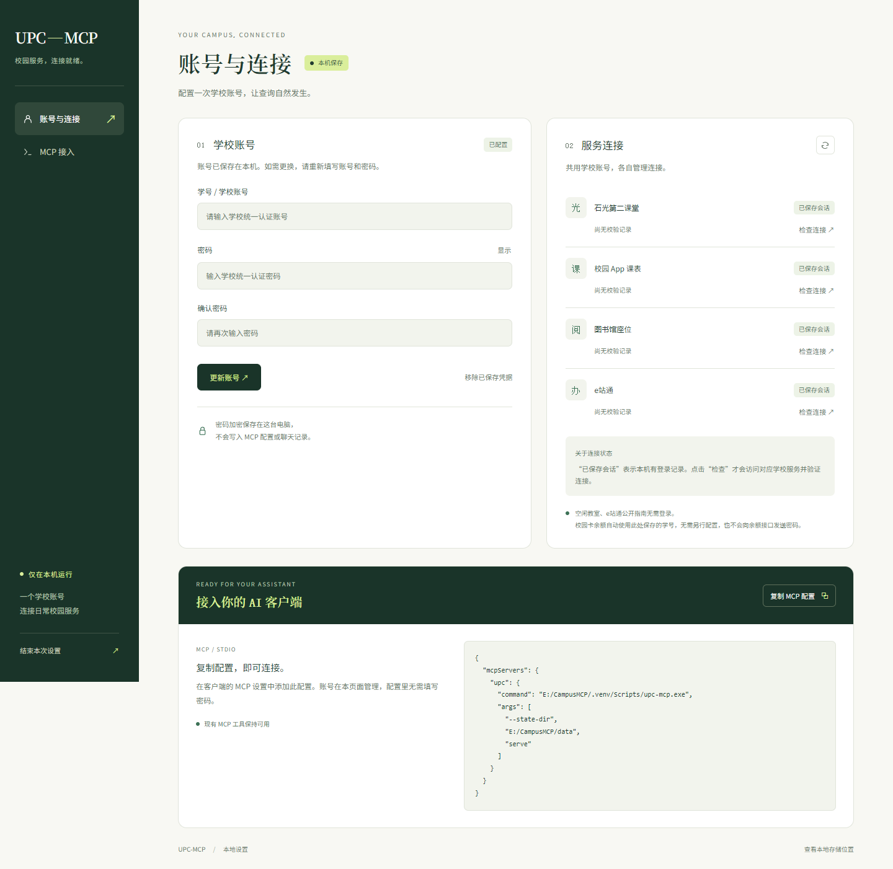

<div align="center">


<p><strong>中国石油大学（华东）校园服务 · 本地运行 · MCP</strong></p>

[](https://github.com/dlam12138/UPC-MCP/releases)
[](https://github.com/dlam12138/UPC-MCP/actions/workflows/ci.yml)


[](LICENSE)

[开始使用](#开始使用) · [让 Agent 配置](#让-agent-配置) · [功能范围](docs/FEATURES.md) · [完整配置指南](docs/CONFIGURATION.md) · [下载 Release](https://github.com/dlam12138/UPC-MCP/releases)

</div>

UPC-MCP 将课表、空闲教室、校园卡、石光、图书馆和 e站通接入支持 MCP 的 AI 客户端。你可以直接问“明天上什么课”“学生证补办需要什么材料”，也可以在明确选择目标后报名活动、预约座位。

这是**非官方、面向本人账号的本地校园工具**。账号密码在本机设置页填写，加密保存；无需把密码发给 Agent，也不需要写进 MCP 配置。

<p align="center"></p>

## 现在能做什么

| 服务 | 能力 | 工具数 |
| --- | --- | ---: |
| 校园卡 | 本人余额、未结算金额 | 1 |
| 空闲教室 | 唐岛湾 / 古镇口，按日期和节次；全部范围先给按楼概览，1–2 栋逐间对照学校记录 | 1 |
| 石光第二课堂 | 活动搜索与详情、参与记录、学分学时、成绩单、报名 | 6 |
| 图书馆 | 馆区、房间、座位、时段、本人预约、预约提交 | 6 |
| 校园 App 课表 | 学期列表、指定教学周课表、最多 14 天自然日期范围 | 3 |
| e站通 | 登录后完整可见目录检索（未登录显式退回公开目录）、办事指南、本人待处理、在办申请状态与可用进度 | 4 |
| 通用 | 能力、本地会话状态与设置入口信息 | 2 |

**23 个工具中，21 个只读，2 个提交操作。** 报名与预约只有在用户明确选择目标并要求提交时才调用；结果未知时不自动重发。[查看全部工具与覆盖边界 →](docs/FEATURES.md)

## 开始使用

**需要：Windows 10/11、Python 3.12+、支持 stdio MCP 的 AI 客户端。** 首版不捆绑 Python，账号存储使用 Windows DPAPI。

### 1. 下载并安装

在 [Releases](https://github.com/dlam12138/UPC-MCP/releases/latest) 下载 `UPC-MCP-v0.1.0-source.zip`，解压到自己的目录，例如 `E:/CampusMCP`，双击 **安装.cmd**。

安装器会在项目内创建 `.venv`、安装依赖并打开设置页，不替换全局 Python。也可以用 Git：

```powershell
git clone https://github.com/dlam12138/UPC-MCP.git E:/CampusMCP
powershell -NoProfile -ExecutionPolicy Bypass -File E:/CampusMCP/scripts/setup.ps1
```

安装时需要联网下载依赖。习惯直接安装 wheel 的用户，可下载 `upc_mcp-0.1.0-py3-none-any.whl`；步骤见[配置指南](docs/CONFIGURATION.md#方式三安装-wheel)。

### 2. 在本机配置账号

在打开的页面填写学校账号、密码和确认密码，点击“保存账号”。按需检查石光、课表、图书馆和 e站通的连接。

- 四个平台共用 CAS 凭据，各自保存业务会话；缺会话或明确失效时自动恢复。
- 空闲教室无需登录；e站通未配置账号时只返回公开目录/公开指南，并在结果中明确标注范围，不能代表本人完整可见内容。
- 空闲教室结果来自学校公开记录，不是现场空位、预约或准入证明；冲突、保留和未校验房间不会进入 `only_available`。
- 校园卡余额自动使用设置页保存的学号，无需重复配置；更换账号后跟随新学号，移除账号后停止查询。余额接口不接收密码，也不需要 CAS 登录。

以后双击 **打开本地设置.cmd** 即可管理账号。页面显示“已保存会话”只代表本地有记录；点击“检查连接”才在线核验。

### 3. 加到 AI 客户端

复制设置页下方的 **MCP 配置**，合并到客户端的 MCP 设置中，保留已有其他服务，然后重新连接。

也可以让程序输出本机真实配置：

```powershell
& E:/CampusMCP/.venv/Scripts/upc-mcp.exe mcp-config
```

配置里只有可执行文件和启动参数，**不需要学校密码**。安装目录和状态目录由本机生成，不要直接复制别人的绝对路径。[客户端配置、指定数据目录与排查 →](docs/CONFIGURATION.md)

## 让 Agent 配置

把下面这段交给有本机终端能力的 Agent。它负责安装和接入，你负责在本机页面填写密码：

```text
请从 https://github.com/dlam12138/UPC-MCP 安装 UPC-MCP，使用我指定的目录。
先读 README.md、docs/CONFIGURATION.md 和 docs/AGENT_SETUP.md。
用 scripts/setup.ps1 -NoBrowser 安装到项目虚拟环境，
再用 upc-mcp mcp-config 生成真实配置，并合并到我当前客户端的 MCP 配置。
保留其他 MCP 服务，设置页和 MCP 使用同一状态目录。
启动 upc-mcp settings，让我在本机页面自行填写账号密码；不要让我把密码发到聊天。
接入后检查 list_tools（预期 23 项）和 upc_capabilities。
不要在安装测试中提交报名、预约、申请或签到。
如果你没有修改客户端配置的权限，请给出准确配置和操作入口，不要声称已完成接入。
```

[完整 Agent 配置指引与验证标准 →](docs/AGENT_SETUP.md)

## 凭据与数据怎么处理

- **密码留在本机**：隐藏输入 / 本地页面，DPAPI CurrentUser 加密；只发往验证 TLS 的官方 CAS HTTPS 登录端点。
- **业务会话分开**：四个平台独立 Cookie/token、锁和代次，清除或换绑会拒绝迟到结果；匿名工具不依赖共同认证。
- **设置页仅本机开放**：随机 loopback 端口、短期启动授权、同源校验和本地资源；没有 CDN 或分析脚本。
- **发布内容已筛选**：不包含任何人的凭据、个人业务原文、浏览器 profile、研究抓包或本地运行状态；界面图使用合成状态。
- **查询结果会进入 AI 客户端**：课程、活动、成绩、申请等返回内容会交给你选用的客户端与模型服务，请根据自己的隐私需求选择。

[隐私与发布审计说明 →](docs/PRIVACY.md)

## 首版的明确边界

- 学校可能要求验证码或二次验证；不承诺永久免交互。
- 课表按周查询；工作区新增最多 14 天的自然日期范围工具（Unreleased），没有整学期工具；e站通待办/在办申请按页返回，`total`、`has_more`、`complete_for_page`、`complete_for_scope` 明确区分单页与全部范围，不声称未读取的页已查完。
- 学校未提供的学分要求、流程节点或进度保持未知。
- 报名、预约提交已有代码与合成测试，**未通过真实提交作为发布验收**；安装和 CI 不会替用户提交。
- 不提供校园卡流水、签到/补签、取消报名、自动抢座或 e站通代提交。

## 开发与文档

```powershell
uv sync --locked --dev
uv run pytest tests -q
uv run ruff check src tests
uv build
```

源码不需要 Node.js；设置页的 HTML、CSS、JavaScript 和字体已随包提供。

| 文档 | 内容 |
| --- | --- |
| [配置指南](docs/CONFIGURATION.md) | 安装、账号、MCP 接入、状态目录和排查 |
| [Agent 配置](docs/AGENT_SETUP.md) | 可复制提示词、自动安装边界和验收 |
| [功能范围](docs/FEATURES.md) | 23 工具与实际覆盖 |
| [架构](docs/ARCHITECTURE.md) | 模块、认证、会话与故障隔离 |
| [隐私](docs/PRIVACY.md) | 凭据、AI 查询数据和发布内容 |
| [更新日志](CHANGELOG.md) | 首版交付与已知限制 |
| [第三方声明](THIRD_PARTY_NOTICES.md) | 协议参考、字体和依赖 |

MIT License。界面字体按 SIL Open Font License 分发，详见第三方声明。学校页面和接口变更可能需要更新适配器。
