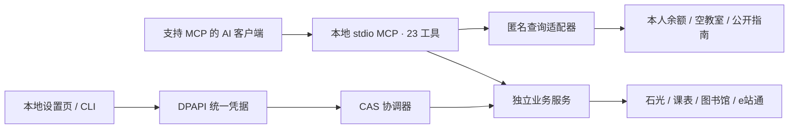

# 实现结构



## 代码

- `src/upc_mcp/server.py`：共享 MCP 入口、能力与状态。
- `src/upc_mcp/auto_auth/`：本地凭据、CAS 动态表单/票据、协调器、锁、退避和各系统 provider。
- `card_balance_*`、`classroom*`、`shiguang*`、`library_*`、`timetable_*`、`service_portal_*`：平台适配器、服务及独立会话存储。
- `settings_ui.py`、`settings_assets/`：短期 loopback 设置服务和离线前端资源。
- `cli.py`：本地设置、会话生命周期、MCP 配置生成及 stdio 启动。
- `tests/`：合成协议、隔离、并发、取消、代次与真实本地 stdio/HTTP 测试，不连接学校。

历史协议兼容模块仍可存在于源码中；它们不注册已废除的流水工具或 CLI 命令，不是当前产品能力。

## 独立性

业务系统分别保存 Cookie/token、代次与锁。共同 CAS 锁只覆盖认证/取票/检查点，不覆盖业务建立或普通查询。慢图书馆请求不会持全局锁拖住课表；匿名查询不依赖共同凭据。

每次读取至多一次明确认证恢复与一次只读重试。403、500、网络、解析或签名错误不一律触发登录。文件锁/DPAPI/同步网络工作移出事件循环；取消等待不提前释放仍被实际工作持有的锁。

写操作在提交前保存本地回执；超时或未知结果不自动重发。清除/换绑后，迟到结果与旧身份不能复活。安装、设置页面加载、工具发现和 CI 都不会提交真实报名/预约。

## 开发

在项目虚拟环境中安装开发依赖，运行：

```powershell
uv sync --locked --dev
uv run pytest tests -q
uv run ruff check src tests
uv build
```

Windows CI 运行相同回归。若修改线上契约，应以合法本人会话做少量必要只读验证，并把原始响应留在本地加密目录；提交到仓库的测试必须使用合成数据。
